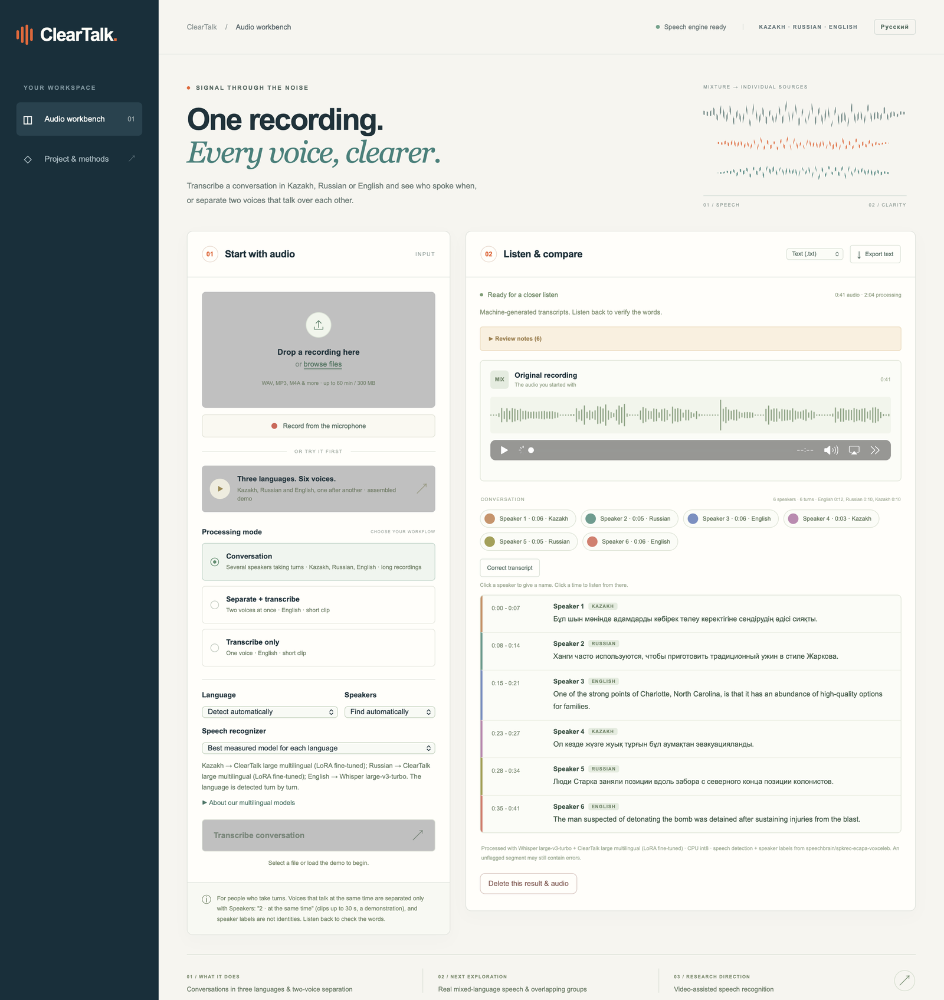
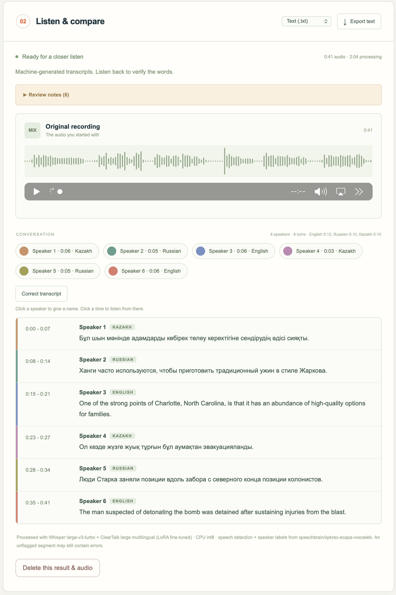
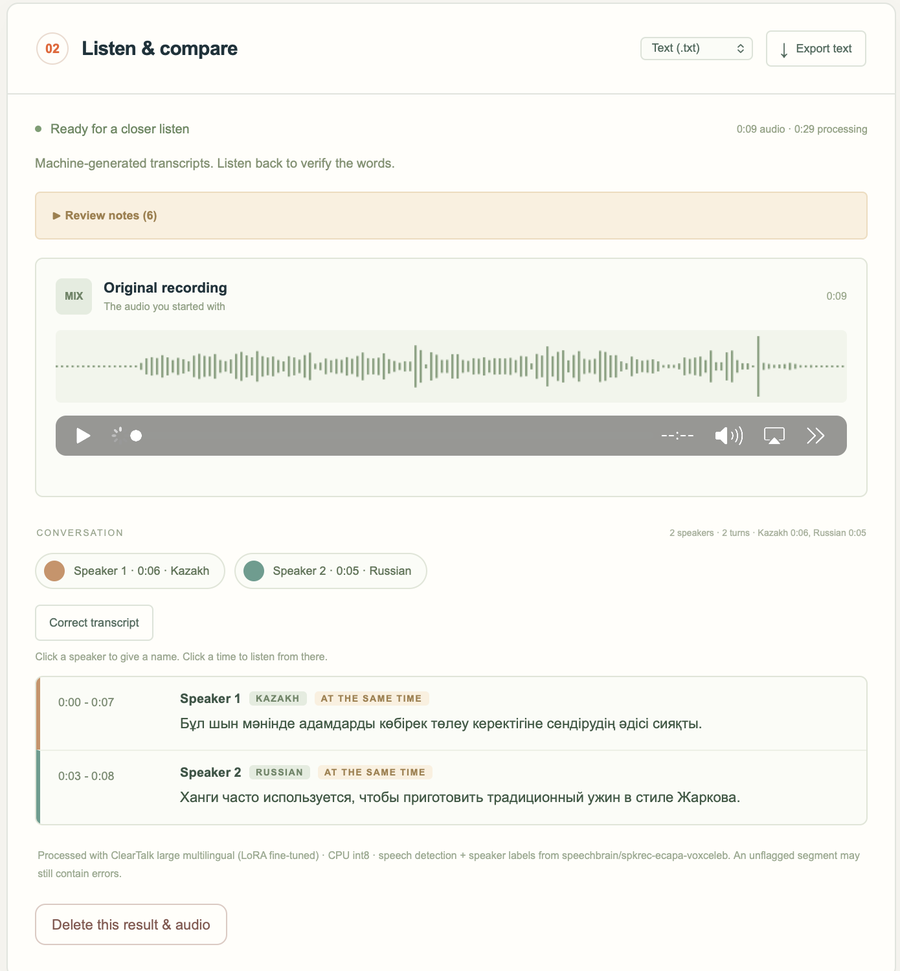
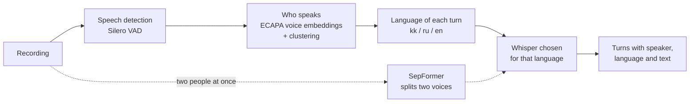

<div align="center">

# ClearTalk

**Speech recognition for real conversations: several speakers, Kazakh, Russian and English in one recording, and two people talking at once.**

[](https://www.python.org/)
[](https://pytorch.org/)
[](https://github.com/openai/whisper)
[](https://fastapi.tiangolo.com/)
[](LICENSE)
[](https://github.com/al1naaa/clear_talk/actions/workflows/tests.yml)

**English** | [Русский](README_RU.md)

</div>



ClearTalk turns a recording of people talking into text: who spoke when, in which language, and what they said.
It is a course project for *Introduction to NLP* (KBTU, fall 2026) built around one question: **where do
ready speech recognizers break, and can a small, carefully evaluated fine-tune fix it?**

## Highlights

- **Three Whisper models fine-tuned with LoRA** on a laptop (a 6 GB GTX 1660 Ti and an Apple M5), training
  0.3% to 2.6% of the parameters.
- **Recordings that switch between Kazakh, Russian and English:** word error rate **30.0% → 9.7%** against the
  model we started from (Whisper large-v3-turbo alone: 43.6%).
- **Two people talking at once (English):** **26.2% → 20.7%** on speakers never seen in training.
- **Background voices:** the app's protections against invented text take a held-out test from **34.4% to 21.0%**.
- **Honest evaluation:** every choice made on validation data, frozen test sets opened once, every step logged.
- **Runs locally:** a FastAPI service with a browser interface; nothing leaves the computer.

## What it does

| Conversation mode | Two people at the same time |
|---|---|
|  |  |
| Finds the turns, labels the speakers, detects the language of every turn and writes it with the best model for that language. Recordings up to 60 minutes. | A Kazakh and a Russian sentence spoken over each other: the voices are separated first, then each is transcribed in its own language. |

Also in the interface: Russian or English interface, recording from the microphone, naming speakers,
correcting the transcript, export to `.txt`, `.srt` and `.vtt`, and an English two-voice mode that shows both
separated tracks ([screenshot](docs/assets/two-voices-english.png)).

## How it works



The recognizer for each language is the one with the fewest errors on validation data. Our large model writes
Kazakh, Russian and recordings that change language; Whisper large-v3-turbo writes English.
Three protections reduce invented text: repetition loops are cut, short quiet background turns are set aside,
and continuous speech is recognized whole instead of being cut at every speaker change.

## Results

Word error rate (WER, lower is better) through the app's own decoding path. All test sets were frozen before
training and scored once.

**Recordings that change language** (final test B, 170 recordings, 6,286 words)

| System | WER |
|---|---|
| Whisper large-v3-turbo, one pass | 43.6% |
| Kazakh Whisper large-v3-turbo (our starting model) | 30.0% |
| ClearTalk small (Whisper small + LoRA) | 16.4% |
| **ClearTalk large (Kazakh turbo + LoRA on the decoder)** | **9.7%** |
| The full app pipeline, "languages change inside turns" | **8.3%** |

**Each language on its own** (final test B, 170 units each)

| Set | Starting model | **ClearTalk large** | Whisper large-v3-turbo |
|---|---|---|---|
| Kazakh, read (FLEURS) | 12.2% | **11.3%** | 23.3% |
| Kazakh, broadcast and read (KSC2) | **9.8%** | 10.3% | 49.5% |
| Russian, read (FLEURS) | 6.9% | 5.2% | **3.7%** |
| Russian, short phrases (Golos) | 20.8% | **17.3%** | 26.4% |
| English, read (FLEURS) | 9.1% | 6.6% | **5.4%** |

**Two people talking at once, English** (final test, speakers never used in training)

| Set | Pretrained Whisper small.en | **ClearTalk English** |
|---|---|---|
| New two-speaker mixtures (300) | 26.16% | **20.74%** |
| Mixtures of the earlier experiment (96) | 33.25% | **29.58%** |
| Clean single speaker (400) | 2.58% | **2.34%** |

**Noise** (final test D, 898 utterances): with the protections, clean 13.1% → 13.0%, white noise at 10 dB
32.9% → 28.3%, other people talking in the background at 10 dB 34.4% → 21.0%.

Every table with 95% bootstrap intervals, the validation numbers and the first-round results:
[docs/DETAILS.md](docs/DETAILS.md).

## Our models

| Model | Base | Trained parameters | Training data | Used for |
|---|---|---|---|---|
| ClearTalk English | Whisper small.en | 6.5 M of 248 M (2.6%) | LibriSpeech pairs mixed, then separated by SepFormer | two voices at once, English |
| ClearTalk small | Whisper small | 6.5 M of 248 M (2.6%) | FLEURS, KSC2, Golos and assembled mixed-language recordings | stand-in for every language |
| ClearTalk large | Kazakh Whisper large-v3-turbo | 2.1 M of 811 M (0.3%), decoder only | the same | Kazakh, Russian, mixed speech |

The fine-tuned weights (0.5 to 1.6 GB each) are not stored in git. Without them the app runs with the ready
models; the training steps to rebuild them are in [docs/DETAILS.md](docs/DETAILS.md).

## Quick start

For the checked Kazakh/Russian overlap demonstration, see [the presentation guide](docs/DEMO_RU.md).
Choose Conversation, Speakers: "2 · at the same time", then load the Kazakh + Russian demo.
The result includes separate playable tracks and attributed transcripts. This is a controlled
demonstration, not a held-out multilingual-overlap accuracy result.

Python 3.12 on macOS, Windows or Linux. A graphics card is optional (NVIDIA only; on a Mac everything runs on
the CPU).

The checked Desktop installation already includes the selected fine-tuned weights. A fresh clone
does not: the commands below install the pretrained baseline. To reproduce the fine-tuned results,
restore your model archive or rebuild the weights using the documented training procedure.

```bash
git clone https://github.com/al1naaa/clear_talk.git
cd clear_talk
python3.12 -m venv .venv
.venv/bin/python -m pip install -r requirements.txt
.venv/bin/python scripts/download_models.py                       # English two-voice mode (about 0.6 GB)
.venv/bin/python scripts/download_multilingual.py --group models  # Conversation mode (about 4.3 GB)
python3.12 -m venv .venv-train
.venv-train/bin/python -m pip install -r requirements-train.txt
.venv-train/bin/python -m cleartalk_ml.convert turbo kazakh small # required before Conversation mode
.venv/bin/python scripts/launch.py                                # opens http://127.0.0.1:8765
```

On Windows use `.venv\Scripts\python` instead of `.venv/bin/python`. The downloaded multilingual models are
converted once with `python -m cleartalk_ml.convert turbo kazakh small` in the training environment
(`requirements-train.txt`). After that, **Start ClearTalk.command** (macOS) or **Start ClearTalk.bat** (Windows)
starts the app with a double click. For tests, install `requirements-dev.txt` into `.venv`, then run
`.venv/bin/python -m pytest -q`. Node.js is required for the browser-state tests; optional model tests
report skips when training libraries or model files are absent.

No computer at hand: `notebooks/ClearTalk_Colab_App.ipynb` runs the app on Google Colab.

## How we kept the evaluation honest

- Train, validation and test follow the recorded corpus split rules. The code audits utterance and sentence
  identity across splits; speaker identity is unavailable in the multilingual manifest.
- A November 10 audit of saved mixture recipes found no shared train/validation utterance IDs but one shared
  normalized transcript. The follow-up documents this issue and removes training/validation text collisions
  before new adaptation. Historical scores above are retained as historical results, not recomputed here.
- Learning rate, checkpoint, the model for each language and every app option were chosen on validation data,
  each by a rule written down before measuring.
- Test sets were frozen before training and opened once (`ml_pipeline/guard.py` refuses a second run). When a
  test set was spent, a new one was frozen for the next round.
- Results that did not work are reported too: training the large model in noise, separating overlapping voices
  inside Conversation mode, and the English model on real AMI meetings, where it was not better.

Each round has a full log with figures and decisions: [English model](ml_pipeline_english/PIPELINE.md),
[small multilingual](ml_pipeline/PIPELINE.md), [large multilingual](ml_pipeline/round2/PIPELINE.md),
[noise and protections](ml_pipeline/round4/PIPELINE.md).

## Project structure

```
backend/              FastAPI service: Conversation mode, separation, speaker labels, decoding
web/                  browser interface (English and Russian)
cleartalk_ml/         multilingual models: corpora, mixed recordings, training, evaluation, export
cleartalk_asr/        English model: mixtures, separation, training, evaluation, export
ml_pipeline/          logs, marimo notebooks and figures of the multilingual rounds
ml_pipeline_english/  log, notebooks and figures of the English model
data/                 frozen recipes, validation and test results, demo audio
samples/              attributed two-voice examples in three languages
scripts/              downloads, unattended training, model selection, packaging, launcher
tests/                tests for the service, the pipeline and the training code
docs/                 detailed results, screenshots and the presentation guide
```

## Limitations

- Mixed-language recordings are assembled from single-language sentences, so every language change is also a
  change of speaker. One person switching language inside a sentence has not been measured.
- Training and testing use read speech, short phrases and broadcasts; live conversations and other microphones
  can behave differently.
- Conversation mode separates people talking at the same time only when asked ("2 · at the same time", clips up
  to 30 s). This is a demonstration and was not measured on a test set.
- "Speaker 1, Speaker 2" are labels inside one recording, not identified people.
- On 28 real overlapping fragments from AMI meetings the English fine-tune was not better than the pretrained
  model.

## Next steps

- Current noise-improvement work: [data audit and proposed experiment](ml_pipeline/noise_followup_20261110/PIPELINE.md).
  No new model has been promoted. Noise robustness and two foreground speakers are evaluated separately.
- Measure on real recordings: the app can save a corrected transcript as a private check example
  (`python -m cleartalk_ml.real` scores them).
- Separate overlapping speech without inventing words.
- Fine-tune the encoder of the large model on a 16 GB GPU.

## Acknowledgements

Ready models: [Whisper](https://github.com/openai/whisper) large-v3-turbo, small and small.en (OpenAI, MIT and
Apache 2.0), [Kazakh Whisper large-v3-turbo](https://huggingface.co/shyngys879/kazakh-whisper-large-v3-turbo)
(Apache 2.0), [SepFormer](https://huggingface.co/speechbrain/sepformer-libri2mix) and
[ECAPA-TDNN](https://huggingface.co/speechbrain/spkrec-ecapa-voxceleb) (SpeechBrain, Apache 2.0), Silero VAD
through [faster-whisper](https://github.com/SYSTRAN/faster-whisper) (MIT).

Data: [FLEURS](https://huggingface.co/datasets/google/fleurs) (CC BY 4.0),
[Kazakh Speech Corpus 2](https://huggingface.co/datasets/issai/Kazakh_Speech_Corpus_2) (MIT),
[Golos](https://huggingface.co/datasets/bond005/sberdevices_golos_10h_crowd) (Sber public licence, non-commercial),
[LibriSpeech](https://www.openslr.org/12/) and LibriSpeech-PC (CC BY 4.0),
[ESC-50](https://github.com/karoldvl/ESC-50) (CC BY-NC 3.0), [AMI](https://groups.inf.ed.ac.uk/ami/corpus/)
(CC BY 4.0).

## License

The code is released under the [MIT License](LICENSE). Models and data keep their own licences (above).
