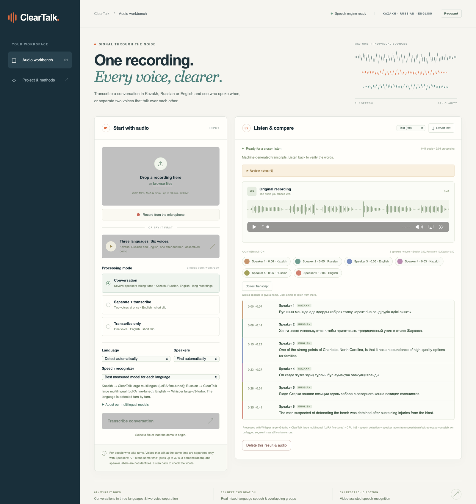
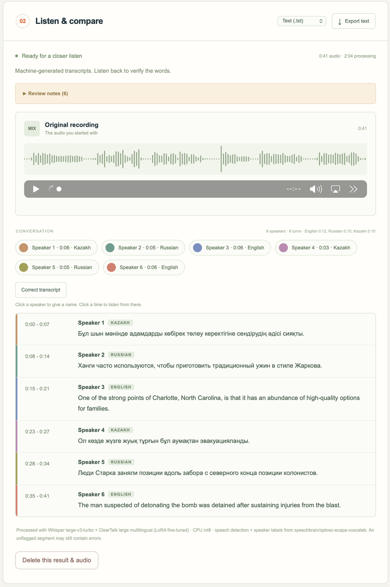
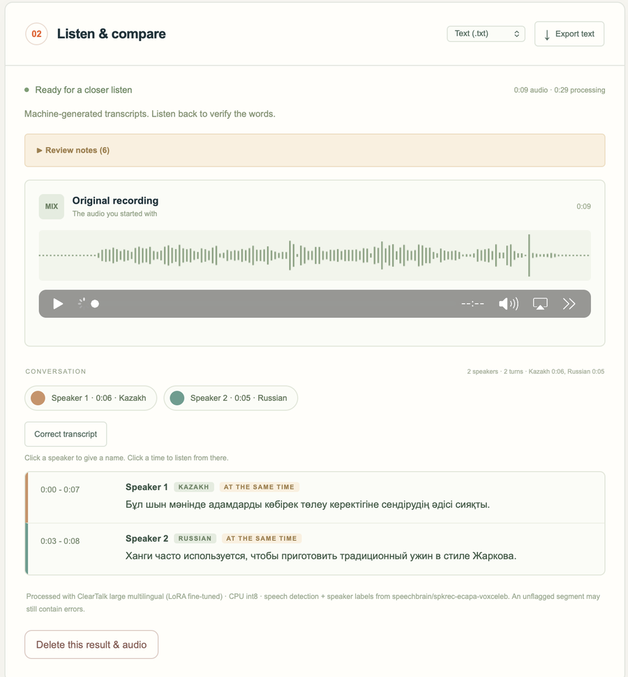
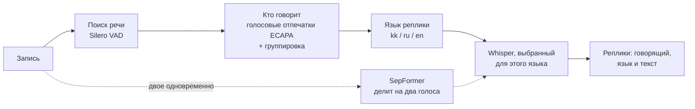

<div align="center">

# ClearTalk

**Распознавание речи в настоящих разговорах: несколько говорящих, казахский, русский и английский в одной записи, и двое, говорящие одновременно.**

[](https://www.python.org/)
[](https://pytorch.org/)
[](https://github.com/openai/whisper)
[](https://fastapi.tiangolo.com/)
[](LICENSE)

[English](README.md) | **Русский**

</div>



ClearTalk превращает запись разговора в текст: кто и когда говорил, на каком языке и что именно сказал.
Это проект курса *Introduction to NLP* (КБТУ, осень 2026), построенный вокруг одного вопроса: **где готовые
распознаватели речи ошибаются и может ли небольшое, честно проверенное дообучение это исправить?**

## Главное

- **Три модели Whisper, дообученные методом LoRA** на ноутбуке (GTX 1660 Ti на 6 ГБ и Apple M5): обучалось
  от 0,3% до 2,6% параметров.
- **Записи, где язык меняется между казахским, русским и английским:** доля ошибок в словах (WER)
  **30,0% → 9,7%** по сравнению с исходной моделью (у Whisper large-v3-turbo - 43,6%).
- **Двое говорят одновременно (английский):** **26,2% → 20,7%** на дикторах, которых не было в обучении.
- **Фоновые голоса:** защиты от выдуманного текста снизили ошибки на отложенном тесте с **34,4% до 21,0%**.
- **Честная проверка:** все решения приняты на проверочных данных, тестовые наборы заморожены заранее и открыты
  один раз, каждый шаг записан в журнал.
- **Работает на своём компьютере:** сервис на FastAPI и страница в браузере, записи никуда не отправляются.

## Что умеет

| Режим «Разговор» | Двое говорят одновременно |
|---|---|
|  |  |
| Находит реплики, размечает говорящих, определяет язык каждой реплики и пишет её моделью, лучшей для этого языка. Записи до 60 минут. | Казахская и русская фразы звучат одновременно: сначала голоса разделяются, затем каждый расшифровывается на своём языке. |

Ещё в интерфейсе: русский и английский язык страницы, запись с микрофона, имена говорящих, исправление текста,
сохранение в `.txt`, `.srt` и `.vtt`, и английский режим двух голосов с обеими разделёнными дорожками
([скриншот](docs/assets/two-voices-english.png)).

## Как это работает



Для каждого языка выбран распознаватель, который меньше всех ошибался на проверочных данных. Наша большая модель
пишет казахский, русский и записи со сменой языка; английский пишет Whisper large-v3-turbo.
Три защиты уменьшают выдуманный текст: обрезаются зацикливания, короткие тихие фоновые кусочки откладываются,
а сплошная речь распознаётся целиком, а не режется при каждой смене говорящего.

## Результаты

Доля ошибок в словах (WER, меньше - лучше), посчитанная через тот же путь расшифровки, что и в приложении.
Все тестовые наборы заморожены до обучения и открыты один раз.

**Записи со сменой языка** (итоговый тест B, 170 записей, 6 286 слов)

| Система | WER |
|---|---|
| Whisper large-v3-turbo за один проход | 43,6% |
| Казахская Whisper large-v3-turbo (исходная для нас) | 30,0% |
| ClearTalk малая (Whisper small + LoRA) | 16,4% |
| **ClearTalk большая (казахская turbo + LoRA в декодере)** | **9,7%** |
| Всё приложение, настройка «Языки меняются в реплике» | **8,3%** |

**Каждый язык отдельно** (итоговый тест B, по 170 фраз)

| Набор | Исходная модель | **ClearTalk большая** | Whisper large-v3-turbo |
|---|---|---|---|
| Казахский, чтение (FLEURS) | 12,2% | **11,3%** | 23,3% |
| Казахский, эфир и чтение (KSC2) | **9,8%** | 10,3% | 49,5% |
| Русский, чтение (FLEURS) | 6,9% | 5,2% | **3,7%** |
| Русский, короткие фразы (Golos) | 20,8% | **17,3%** | 26,4% |
| Английский, чтение (FLEURS) | 9,1% | 6,6% | **5,4%** |

**Двое говорят одновременно, английский** (итоговый тест, дикторы не участвовали в обучении)

| Набор | Готовая Whisper small.en | **ClearTalk английская** |
|---|---|---|
| Новые смеси двух голосов (300) | 26,16% | **20,74%** |
| Смеси раннего эксперимента (96) | 33,25% | **29,58%** |
| Чистая речь одного человека (400) | 2,58% | **2,34%** |

**Шум** (итоговый тест D, 898 фраз): с защитами без шума 13,1% → 13,0%, белый шум 10 дБ 32,9% → 28,3%,
люди говорят фоном (10 дБ) 34,4% → 21,0%.

Все таблицы с 95% доверительными интервалами, числа на проверке и результаты первого раунда:
[docs/DETAILS_RU.md](docs/DETAILS_RU.md).

## Наши модели

| Модель | Основа | Обучено параметров | Данные | Где используется |
|---|---|---|---|---|
| ClearTalk английская | Whisper small.en | 6,5 млн из 248 млн (2,6%) | пары LibriSpeech, смешанные и разделённые SepFormer | двое одновременно, английский |
| ClearTalk малая | Whisper small | 6,5 млн из 248 млн (2,6%) | FLEURS, KSC2, Golos и собранные записи со сменой языка | запасная для всех языков |
| ClearTalk большая | казахская Whisper large-v3-turbo | 2,1 млн из 811 млн (0,3%), только декодер | те же | казахский, русский, смешанная речь |

Веса дообученных моделей (от 0,5 до 1,6 ГБ каждая) в git не хранятся. Без них приложение работает с готовыми
моделями; как обучить их заново - в [docs/DETAILS_RU.md](docs/DETAILS_RU.md).

## Быстрый старт

Python 3.12 на macOS, Windows или Linux. Видеокарта не обязательна (только NVIDIA; на Mac всё считается на
процессоре).

```bash
git clone https://github.com/al1naaa/clear_talk.git
cd clear_talk
python3.12 -m venv .venv
.venv/bin/python -m pip install -r requirements.txt
.venv/bin/python scripts/download_models.py                       # английский режим двух голосов (около 0,6 ГБ)
.venv/bin/python scripts/download_multilingual.py --group models  # режим «Разговор» (около 4,3 ГБ)
python3.12 -m venv .venv-train
.venv-train/bin/python -m pip install -r requirements-train.txt
.venv-train/bin/python -m cleartalk_ml.convert turbo kazakh small
.venv/bin/python scripts/launch.py                                # откроет http://127.0.0.1:8765
```

На Windows вместо `.venv/bin/python` пишется `.venv\Scripts\python`. Скачанные многоязычные модели один раз
переводятся в формат приложения командой `python -m cleartalk_ml.convert turbo kazakh small` в среде для
обучения (`requirements-train.txt`). После этого приложение запускается двойным щелчком по
**Start ClearTalk.command** (macOS) или **Start ClearTalk.bat** (Windows). Тесты: `.venv/bin/python -m pytest -q`.

Без своего компьютера: `notebooks/ClearTalk_Colab_App.ipynb` запускает приложение в Google Colab.

## Как мы проверяли честно

- Обучение, проверка и тест следуют записанным правилам деления корпусов; код проверяет идентификаторы записей и предложений. Идентификаторов говорящих в многоязычном корпусе нет.
- Проверка 10 ноября нашла в сохранённых рецептах одно совпадение нормализованного текста между обучением и валидацией, при отсутствии общих идентификаторов записей. Перед новым обучением такие совпадения исключаются из тренировочной части. Таблицы выше содержат сохранённые исторические результаты.
- Скорость обучения, сохранённое состояние модели, модель для каждого языка и все настройки приложения выбраны на
  проверочных данных, каждая по правилу, записанному до замера.
- Тестовые наборы заморожены до обучения и открыты один раз (`ml_pipeline/guard.py` не даёт запустить второй
  раз). Когда тест был потрачен, для следующего раунда замораживался новый.
- То, что не сработало, тоже записано: обучение большой модели в шуме, разделение одновременной речи внутри
  режима «Разговор» и английская модель на настоящих встречах AMI, где она не оказалась лучше.

У каждого раунда есть полный журнал с графиками и решениями: [английская модель](ml_pipeline_english/PIPELINE.md),
[малая многоязычная](ml_pipeline/PIPELINE.md), [большая многоязычная](ml_pipeline/round2/PIPELINE.md),
[шум и защиты](ml_pipeline/round4/PIPELINE.md).

## Структура проекта

```
backend/              сервис FastAPI: режим «Разговор», разделение голосов, метки говорящих, расшифровка
web/                  страница в браузере (русский и английский)
cleartalk_ml/         многоязычные модели: корпуса, записи со сменой языка, обучение, оценка, экспорт
cleartalk_asr/        английская модель: смеси, разделение, обучение, оценка, экспорт
ml_pipeline/          журналы, блокноты marimo и графики многоязычных раундов
ml_pipeline_english/  журнал, блокноты и графики английской модели
data/                 замороженные рецепты, результаты проверки и тестов, демо-записи
samples/              фрагменты настоящих встреч (AMI) и примеры одновременной речи на трёх языках
scripts/              загрузки, обучение без присмотра, выбор модели, упаковка, запуск
tests/                тесты сервиса, конвейера и кода обучения
docs/                 подробные результаты, скриншоты и слайды
archive/              ранний эксперимент: небольшая сеть, которая чистила разделённый звук
```

## Ограничения

- Записи со сменой языка собраны из фраз на одном языке, поэтому каждая смена языка - это и смена говорящего.
  Переключение языка одним человеком посреди фразы не измерялось.
- Обучение и тесты - на чтении, коротких фразах и эфире; живые разговоры и другие микрофоны могут вести себя иначе.
- Одновременную речь режим «Разговор» разделяет, только если выбрать «2 · говорят одновременно» (записи до 30 с).
  Это демонстрация, на тестовом наборе она не измерялась.
- «Говорящий 1, Говорящий 2» - метки внутри одной записи, а не установленные личности.
- На 28 фрагментах настоящих встреч AMI английская дообученная модель не оказалась лучше готовой.

## Что дальше

- Измерить на живых записях: приложение умеет сохранить исправленную расшифровку как личный проверочный пример
  (`python -m cleartalk_ml.real` считает по ним ошибки).
- Разделять одновременную речь, не выдумывая слов.
- Дообучить «слух» (энкодер) большой модели на видеокарте на 16 ГБ.

## Благодарности

Готовые модели: [Whisper](https://github.com/openai/whisper) large-v3-turbo, small и small.en (OpenAI, MIT и
Apache 2.0), [казахская Whisper large-v3-turbo](https://huggingface.co/shyngys879/kazakh-whisper-large-v3-turbo)
(Apache 2.0), [SepFormer](https://huggingface.co/speechbrain/sepformer-libri2mix) и
[ECAPA-TDNN](https://huggingface.co/speechbrain/spkrec-ecapa-voxceleb) (SpeechBrain, Apache 2.0), Silero VAD
через [faster-whisper](https://github.com/SYSTRAN/faster-whisper) (MIT).

Данные: [FLEURS](https://huggingface.co/datasets/google/fleurs) (CC BY 4.0),
[Kazakh Speech Corpus 2](https://huggingface.co/datasets/issai/Kazakh_Speech_Corpus_2) (MIT),
[Golos](https://huggingface.co/datasets/bond005/sberdevices_golos_10h_crowd) (лицензия Сбера, некоммерческая),
[LibriSpeech](https://www.openslr.org/12/) и LibriSpeech-PC (CC BY 4.0),
[ESC-50](https://github.com/karoldvl/ESC-50) (CC BY-NC 3.0), [AMI](https://groups.inf.ed.ac.uk/ami/corpus/)
(CC BY 4.0).

## Лицензия

Код распространяется по [лицензии MIT](LICENSE). У моделей и данных свои лицензии (см. выше).
