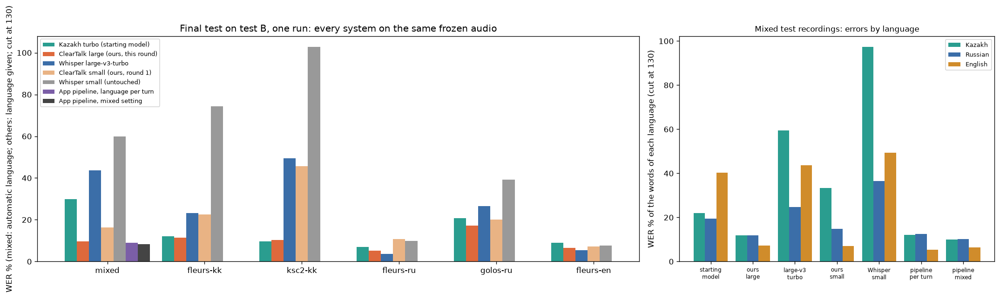
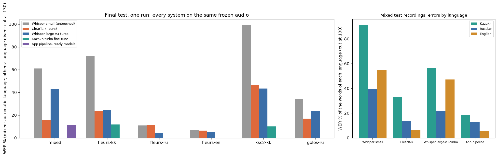
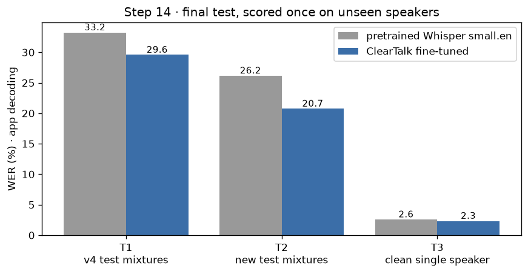

# ClearTalk: detailed results and methods

ClearTalk turns a recording of people talking into text. It has two modes:

- **Conversation** - several people taking turns in **Kazakh, Russian or English** (the language may change
  from turn to turn), recordings up to an hour. The app finds the turns, labels who spoke
  (Speaker 1, Speaker 2 …), detects each turn's language and writes it down.
- **Two voices at once** - a short noisy English recording of two people talking at the same time is
  separated into two tracks and each is transcribed.

The project's own trained models are three Whisper recognizers **fine-tuned with LoRA**:

1. Whisper small.en for voices that have been through the separator (the English two-voice mode).
2. Multilingual Whisper small for Kazakh, Russian, English and recordings that change language.
3. A large multilingual recognizer: the Kazakh fine-tune of Whisper large-v3-turbo with its text-writing part
   (the decoder) adapted to the three languages and to recordings that change language.

```
Conversation:  upload ─► speech detection ─► who speaks (voice embeddings + clustering) ─► language of the turn ─► Whisper for that language ─► text
Two voices:    upload ─► SepFormer (pretrained) ─► 2 voices ─► Whisper small.en (pretrained or ours) ─► text
```

## Results: the large multilingual model

Word error rate (lower is better). Every system gets the same audio and runs through the app's decoding path
(faster-whisper, beam 5, speech detection). Mixed recordings: language detected automatically; other sets:
language given. The baseline is the model the training started from, untouched.

<!-- multilingual-large-results:start -->
| Set | Kazakh turbo (starting model) | **ClearTalk large (LoRA)** | Change (95% bootstrap) | Whisper large-v3-turbo | ClearTalk small (round 1) | App pipeline: language per turn / mixed setting |
|---|---|---|---|---|---|---|
| **Final test B** · Mixed-language recordings (170, 6,286 words) | 30.0% | **9.7%** | -20.3 points (-24.2 … -16.3) | 43.6% | 16.4% | 9.1% / 8.3% |
| **Final test B** · Kazakh · read sentences (FLEURS) (170, 2,880 words) | 12.2% | **11.3%** | -0.8 points (-1.8 … +0.0) | 23.3% | 22.5% | - |
| **Final test B** · Kazakh · broadcast and read speech (KSC2) (170, 1,856 words) | 9.8% | **10.3%** | +0.5 points (-0.5 … +1.7) | 49.5% | 45.6% | - |
| **Final test B** · Russian · read sentences (FLEURS) (170, 3,454 words) | 6.9% | **5.2%** | -1.7 points (-2.6 … -0.8) | 3.7% | 10.8% | - |
| **Final test B** · Russian · short phrases (Golos) (170, 855 words) | 20.8% | **17.3%** | -3.5 points (-6.1 … -1.2) | 26.4% | 20.0% | - |
| **Final test B** · English · read sentences (FLEURS) (170, 3,874 words) | 9.1% | **6.6%** | -2.5 points (-3.5 … -1.5) | 5.4% | 7.3% | - |

| Set | Kazakh turbo (starting model) | **ClearTalk large (LoRA)** | Change (95% bootstrap) | Whisper large-v3-turbo | ClearTalk small (round 1) | App pipeline: language per turn / mixed setting |
|---|---|---|---|---|---|---|
| **Validation** · Mixed-language recordings (300, 10,980 words) | 30.9% | **9.8%** | -21.1 points (-24.1 … -18.0) | 47.7% | 16.1% | 9.9% / 8.2% |
| **Validation** · Kazakh · read sentences (FLEURS) (369, 5,877 words) | 12.2% | **10.6%** | -1.5 points (-2.3 … -0.8) | 26.2% | 24.2% | - |
| **Validation** · Kazakh · broadcast and read speech (KSC2) (400, 4,522 words) | 9.4% | **10.3%** | +0.9 points (+0.2 … +1.5) | 46.6% | 41.6% | - |
| **Validation** · Russian · read sentences (FLEURS) (356, 6,501 words) | 7.3% | **5.3%** | -2.0 points (-2.9 … -1.2) | 4.0% | 9.5% | - |
| **Validation** · Russian · short phrases (Golos) (400, 1,925 words) | 16.8% | **14.2%** | -2.6 points (-3.9 … -1.4) | 21.0% | 15.8% | - |
| **Validation** · English · read sentences (FLEURS) (394, 8,241 words) | 9.7% | **6.9%** | -2.8 points (-3.7 … -2.0) | 5.6% | 7.4% | - |

- Test B is the second frozen test set (170 units per set, 1,020 in all): recordings that no system transcribed in the first test. It was opened **once**, after the checkpoint, the routes and the recognizer for the "languages change inside turns" setting were fixed on validation.
- **The main result: recordings that change language, in one pass.** On final test B the untouched Kazakh turbo fine-tune gets 30.0% of the words wrong, our large model 9.7%; our small model of round 1 16.4%, Whisper large-v3-turbo 43.6%.
- **Kazakh:** read sentences 12.2% → 11.3%; broadcast and read speech (KSC2) 9.8% → 10.3% - on the test the difference is within noise (+0.5 points (-0.5 … +1.7)), but on validation the model is **worse than the starting model** (9.4% → 10.3%, +0.9 points (+0.2 … +1.5)). Its authors trained it on KSC2 and do not say whether these test folders were held out, so its number may flatter it; the fact remains that we did not improve on it there.
- **Russian and English** are recovered part of the way: Russian 6.9% → 5.2% (FLEURS) and 20.8% → 17.3% (Golos), English 9.1% → 6.6%. Untouched Whisper large-v3-turbo: Russian 3.7% and 26.4%, English 5.4%.
- **In the app** (decided on validation): Kazakh → our large model, Russian → our large model, English → Whisper large-v3-turbo; the "languages change inside turns" setting → our large model. The app's pipeline on mixed recordings: language per turn 9.1%, "languages change inside turns" 8.3%.
- 2,129,920 of 811,008,000 parameters were trained (0.3%) - only the part of the model that writes text (the decoder); the part that hears is frozen. One epoch of 14,400 examples (the same as for the small model), about 5 hours on a GTX 1660 Ti.
<!-- multilingual-large-results:end -->



## Noise, short and long recordings

How the app copes with background noise, very short phrases and long conversations (`python -m cleartalk_ml.robustness`).

<!-- robustness-results:start -->
| Validation recordings | clean | white noise 20 dB | white noise 10 dB | babble 10 dB | babble 5 dB |
|---|---|---|---|---|---|
| Mixed-language recordings (20-30 s) | 8.2% | 11.5% → **10.6%** | 21.7% → **19.0%** | 38.7% → **22.4%** | 67.4% → **41.2%** |
| Conversations of 7 minutes | 11.8% → **8.2%** | - | 25.9% → **15.5%** | 30.2% → **14.9%** | - |
| Short phrases ≤ 4 s · Kazakh | 18.6% | 24.7% → 25.9% | 35.4% | 27.1% → **26.2%** | 44.8% → 48.2% |
| Short phrases · Russian | 20.8% | 24.2% | 39.9% | 42.1% → **34.8%** | 76.4% → **57.3%** |
| Short phrases · English | 5.8% | 7.7% | 13.2% → **10.3%** | 46.8% → **10.3%** | 28.2% → **16.8%** |

WER through the app (language detected per turn) before → after the protections of round 4; **bold** = better, one number = unchanged. Noise is added to validation recordings; "babble" is 3-5 other people talking; dB says how much louder the speech is than the noise. - = not measured.

- **Repetition loops** are cut back to three occurrences (a recogniser stuck in a loop wrote "Senate" 213 times); every mode.
- **Background voices.** A turn of at most 3 s that is at least 5 dB quieter than the conversation and at most 10 dB above the background is set aside: listed under the transcript, left out of the text and the exports. Validation 25.2% → 20.7%, -4.5 (-5.5 … -3.5); babble 10 dB 32.7% → 22.4%; clean unchanged.
- **Whole stretches of speech.** The recogniser gets each stretch of continuous speech whole (a breath pause of one person no longer cuts the sentence) and its sentences are given to speakers by time. Validation 20.7% → 17.8%, -2.9 (-3.8 … -2.0); clean 7-minute conversations 11.8% → 8.2%.
- **People talking at once** - separating them was measured and **not adopted**: on held-out overlap recordings the error fell 33.7% → 16.0%, but in ordinary and noisy conversations it invented words - one voice spread over two tracks, background talkers written as a second voice (robustness recordings 17.8% → 29.0%).

Not adopted (each by its pre-registered rule): training the large model in noise (noisy validation 26.3% → 26.7%), two earlier variants of whole-stretch transcription, the first overlap variant, and the narrower Kazakh cross-check (-0.2 (-0.6 … +0.3)). Details: `ml_pipeline/round4/PIPELINE.md`.

**Final test D** (once; 898 utterances no system had seen, each clean, with white noise 10 dB and with babble 10 dB; one person per recording): the app before → after the protections: clean 13.1% → 13.0% (-0.1 (-0.3 … +0.0)), white noise 10 dB 32.9% → 28.3% (-4.5 (-9.2 … -1.6)), babble 10 dB 34.4% → 21.0% (-13.3 (-15.5 … -11.2)); all 26.8% → 20.8%.
<!-- robustness-results:end -->

## Results: the small multilingual model

The first round of training. Same measuring as above; the baseline is untouched Whisper small. The app's routes
named in this section are those decided after that round; the large model above changed them.

<!-- multilingual-results:start -->
| Set | Whisper small (untouched) | **ClearTalk (LoRA)** | Change (95% bootstrap) | Whisper large-v3-turbo | Kazakh turbo | App pipeline (ready models) |
|---|---|---|---|---|---|---|
| **Final test** · Mixed-language recordings (300, 11,852 words) | 60.9% | **15.9%** | -45.0 points (-49.8 … -41.0) | 42.7% | - | 11.3% |
| **Final test** · Kazakh · read sentences (FLEURS) (300, 5,411 words) | 72.0% | **23.6%** | -48.4 points (-52.8 … -45.3) | 24.2% | 11.8% | - |
| **Final test** · Russian · read sentences (FLEURS) (300, 5,811 words) | 11.0% | **11.5%** | +0.5 points (-0.4 … +1.4) | 4.5% | - | - |
| **Final test** · English · read sentences (FLEURS) (300, 6,736 words) | 6.7% | **6.4%** | -0.3 points (-0.9 … +0.2) | 5.1% | - | - |
| **Final test** · Kazakh · broadcast and read speech (KSC2) (300, 3,209 words) | 99.5% | **46.3%** | -53.2 points (-62.1 … -45.4) | 43.3% | 9.9% | - |
| **Final test** · Russian · short phrases (Golos) (300, 1,542 words) | 34.0% | **16.9%** | -17.2 points (-21.2 … -13.4) | 23.3% | - | - |

| Set | Whisper small (untouched) | **ClearTalk (LoRA)** | Change (95% bootstrap) | Whisper large-v3-turbo | Kazakh turbo | App pipeline (ready models) |
|---|---|---|---|---|---|---|
| **Validation** · Mixed-language recordings (300, 10,980 words) | 60.0% | **16.1%** | -43.9 points (-49.0 … -39.4) | 47.7% | - | 10.8% |
| **Validation** · Kazakh · read sentences (FLEURS) (369, 5,877 words) | 74.5% | **24.2%** | -50.3 points (-54.0 … -47.1) | 26.2% | 12.2% | - |
| **Validation** · Russian · read sentences (FLEURS) (356, 6,501 words) | 9.1% | **9.5%** | +0.4 points (-0.4 … +1.1) | 4.0% | 7.3% | - |
| **Validation** · English · read sentences (FLEURS) (394, 8,241 words) | 7.4% | **7.4%** | +0.0 points (-0.5 … +0.5) | 5.6% | 9.7% | - |
| **Validation** · Kazakh · broadcast and read speech (KSC2) (400, 4,522 words) | 103.7% | **41.6%** | -62.2 points (-71.0 … -54.8) | 46.6% | 9.4% | - |
| **Validation** · Russian · short phrases (Golos) (400, 1,925 words) | 45.0% | **15.8%** | -29.2 points (-55.0 … -15.2) | 21.0% | 16.8% | - |

- The test units were opened **once**, after the checkpoint, the promotion rule and the app's routes were fixed on validation. 300 units per set.
- **The main result: recordings that change language.** On the final test untouched Whisper small gets 60.9% of the words wrong, our model 15.9%. The untouched model drops whole utterances after a language change: on validation missing words fall from 4,079 to 272, and our model is better on 289 of 300 recordings.
- **Kazakh:** 72.0% → 23.6% on read sentences. Russian and English barely move (11.0% → 11.5% and 6.7% → 6.4%) - which is what the rule "no language worse" asked for.
- **The large ready models are still stronger where they exist:** the Kazakh fine-tune on Kazakh (11.8%), large-v3-turbo on Russian and English (4.5% and 5.1%). So after this round the app sent Kazakh to the Kazakh turbo fine-tune, Russian to Whisper large-v3-turbo and English to Whisper large-v3-turbo (decided on validation; the large model of the second round changed these routes, see the section above).
- **On mixed recordings the app's pipeline does best** (it cuts the recording into turns and detects each turn's language): 11.3% with ready models (the routes of round 1), against 15.9% for our model in one pass and 42.7% for large-v3-turbo in one pass.
- Our model passed the pre-registered promotion rule and is the stand-in recognizer: the app uses it for every language on a computer without the large models.
- 6,488,064 of 248,222,976 parameters were trained (2.6%); one epoch of 14,400 examples, 9,000 of them mixed-language recordings.
<!-- multilingual-results:end -->



## Results: the English two-voice model

Same audio for both recognizers. All speakers below were never used in training.

| Set | Pretrained Whisper small.en | **ClearTalk (LoRA)** | Change (95% bootstrap) |
|---|---|---|---|
| **Final test** · new two-speaker mixtures (300, 9,367 words) | 26.16% | **20.74%** | -5.41 points (-7.63 … -3.65) |
| **Final test** · two-speaker mixtures from the earlier experiment (96, 3,080 words) | 33.25% | **29.58%** | -3.67 points (-5.61 … -1.88) |
| **Final test** · clean single speaker (400, 7,494 words) | 2.58% | **2.34%** | -0.24 points (-0.55 … +0.04) |
| Validation · two-speaker mixtures (300, 9,887 words) | 28.87% | 21.77% | -7.10 points (-12.87 … -1.87) |
| Validation · clean single speaker (300) | 2.99% | 2.79% | -0.20 points |

- The test sets were scored **once**, after the checkpoint and the default were fixed on validation.
- 6,488,064 of 248,222,208 parameters were trained (2.6%); one epoch over 17,632 separated tracks from 249 speakers.
- The gain comes mostly from fewer **insertions** (the model stops transcribing the leaked second voice) and
  fewer substitutions. It is largest at 5-15 dB SNR and almost absent at 0 dB, where the separator itself fails.
- Earlier experiment for comparison (same 96 mixtures, same legacy metric): a spectral refiner moved WER
  from 33.79% to 33.69%; adapting the recognizer gives 29.85%.



## Use the app

**Windows:** double-click **Start ClearTalk.bat** and keep the window open.
**macOS:** double-click **Start ClearTalk.command** and keep the Terminal window open.

The browser opens http://127.0.0.1:8765. Upload a recording or load a demo, then pick a mode:

- **Conversation** - language (automatic, Kazakh, Russian, English, or "languages change inside turns"),
  number of speakers (automatic or 1-8), recognizer (the best measured model for each language, or one model
  for everything, ours included); recordings up to 60 minutes. Each turn is shown with its time (click to
  listen from there), speaker, language and text; doubtful turns carry a CHECK flag.
- **Separate + transcribe** - two voices at once, English, up to 20 s.
- **Transcribe only** - one voice, English, up to 20 s.

With an NVIDIA graphics card Conversation mode runs on it; otherwise on the CPU (slower, same result path).
Everything is processed on the computer itself.

**On Google Colab instead of your computer:** `notebooks/ClearTalk_Colab_App.ipynb` (made by
`scripts/build_colab_app.py`) unpacks the archives from your Google Drive, runs the app on Colab's GPU and opens it
through Colab's own proxy - a link that works only for the signed-in user; nothing is published.

What else the page does:

- **Interface in Russian or English** - the button in the top right corner; the choice is remembered.
  Recognized speech, speaker names and file names are never translated.
- **Record from the microphone** instead of choosing a file.
- **Name the speakers** - click "Speaker 1" and type a name; it is used on the page and in every export.
- **Correct the transcript** - "Correct transcript" makes the text and the language of each turn editable.
- **Export** the conversation as text, or as subtitles (`.srt`, `.vtt`) with the names and corrections.
- **Languages change inside turns** - when people switch language in the middle of a turn, this setting sends
  every turn to the recognizer trained on recordings that change language (chosen on validation, see
  `models/multilingual/profile.json`), instead of one recognizer per detected language.
- **Check examples** - after correcting a transcript, "Save as check example" keeps the recording and the
  corrected text in `data/real/` on this computer (only with everybody's consent; the folder is never
  versioned or packaged). `python -m cleartalk_ml.real` then scores every way of transcribing on these
  real recordings. This is how the app can be measured on natural mixed speech, which the public data lack.

Fresh install (Python 3.12):

```sh
python3.12 -m venv .venv
.venv/bin/python -m pip install -r requirements.txt
.venv/bin/python scripts/download_models.py          # models of the English two-voice mode
.venv/bin/python scripts/prepare_demo.py
.venv/bin/python scripts/launch.py
```

The models of Conversation mode are either unpacked from the archive written by `scripts/package_models.py`
or rebuilt: `python scripts/download_multilingual.py --group models`, then
`python -m cleartalk_ml.convert turbo kazakh small` (training environment). The fine-tuned recognizers are
produced by the training steps below; without them the app offers the ready recognizers only.
On Windows with an NVIDIA card install PyTorch from the CUDA wheel index first
(`pip install torch==2.8.0 torchaudio==2.8.0 --index-url https://download.pytorch.org/whl/cu126`).

## How Conversation mode works

1. **Speech detection** (Silero VAD) finds the stretches with speech.
2. **Who speaks.** Each stretch is cut into short windows; an ECAPA-TDNN model turns a window into a voice
   embedding; similar embeddings are clustered - each cluster is a speaker. The number of speakers is found
   automatically or given. The clustering threshold was chosen on assembled validation conversations.
3. **Language of the turn.** Whisper scores the language, restricted to the three supported ones (otherwise a
   short Russian phrase can be taken for Ukrainian). A very short turn takes its speaker's language.
4. **Text.** The turn goes to the recognizer that made the fewest errors for that language on validation data
   (the "routes" in `models/multilingual/profile.json`), or to one recognizer chosen by the user. With the
   setting "languages change inside turns" every turn goes to one recognizer instead - the one with the fewest
   errors on validation recordings that change language (`mixed_recognizer` in the same file) - and the turn's
   language label is read from the text it wrote. Two options in the same file, both adopted on validation after
   the final test: a turn whose language detection is uncertain (or that is shorter than 2 s) goes to that
   recognizer too, because it writes what it hears whatever the token (mixed validation recordings 9.9% → 7.8%,
   English unchanged); and in the "languages change inside turns" setting the detector is not run at all
   (8.2% → 8.2%, one large-model pass less per turn - faster on a computer without a graphics card).
5. **Graphics memory.** Turns are transcribed recognizer by recognizer and put back in spoken order; a recognizer
   that no longer fits in the card's memory is unloaded (the one used longest ago first), so a 6 GB card works
   with any routes.

<!-- protections:start -->
6. **Protections against invented text** (round 4, each adopted on validation by a rule written before measuring): repetition loops are cut back; short quiet turns near the background level are set aside (listed under the transcript); every stretch of continuous speech goes to the recogniser whole and its sentences are given to speakers by time. Separating people who talk at the same time was measured and not adopted (it invented words in ordinary conversations).
<!-- protections:end -->

Ready models are used as published: Whisper large-v3-turbo (OpenAI, MIT), its Kazakh fine-tune
(shyngys879/kazakh-whisper-large-v3-turbo, Apache 2.0), multilingual Whisper small (Apache 2.0) and
ECAPA-TDNN speaker embeddings (SpeechBrain, Apache 2.0).

## How the large multilingual model was trained

The second round. All steps, figures and decisions are logged in
[`ml_pipeline/round2/PIPELINE.md`](../ml_pipeline/round2/PIPELINE.md); the notebooks are next to it.

1. **Why a second model.** The errors left by the small model were wrong words - a matter of how well the model
   hears, which a small model cannot be taught on a laptop. The large ready models hear well but, in a recording
   that changes language, keep writing in the language they started with or drop the rest.
2. **Starting point** - the Kazakh fine-tune of Whisper large-v3-turbo (shyngys879/kazakh-whisper-large-v3-turbo,
   Apache 2.0): the best Kazakh of the installed models, with Russian and English damaged but not lost.
3. **Fine-tuning** - LoRA (rank 16) on the four **decoder** layers only: 2,129,920 of 811,008,000 parameters. The
   encoder (the part that hears) is frozen, so no gradients run through it and the training fits a 6 GB card.
   The same 14,400 training examples as for the small model, one epoch, about five hours.
4. **A second frozen test set (test B)** - 1,020 units drawn from test recordings that the first final test never
   transcribed, frozen before any training of this round. The first test set was already spent.
5. **Rules written down before training** - the app's routes by lowest pooled validation WER per language; the
   recognizer for the "languages change inside turns" setting by lowest one-pass WER on mixed validation
   recordings; and a promise to report plainly if Kazakh got worse than with the starting model.

```sh
.venv-train\Scripts\python -m cleartalk_ml.round2               # recipes of test B, freeze its units
.venv-train\Scripts\python ml_pipeline\round2\r2_prep.py        # steps 1-8
bash scripts/night_round2.sh                                    # training (resumable), then scripts\select_round2.py
.venv-train\Scripts\python ml_pipeline\round2\r2_model.py       # steps 9-12
.venv-train\Scripts\python -m cleartalk_ml.final_test_b         # step 14, once
.venv-train\Scripts\python ml_pipeline\round2\r2_eval.py        # steps 13-16
.venv-train\Scripts\python scripts\check_round2_deployment.py
```

## How the small multilingual model was trained

The first round. All steps, figures and decisions are logged in [`ml_pipeline/PIPELINE.md`](../ml_pipeline/PIPELINE.md);
the marimo notebooks in `ml_pipeline/` show every figure.

1. **Data** (all public, ungated) - FLEURS read sentences in the three languages (CC BY 4.0); the beginning of the
   Kazakh Speech Corpus 2 (MIT): crowdsourced read speech for training, and its official Test folders (read
   speech, TV, radio, parliament, podcasts, talk shows) divided into a validation half and a test half; the Golos
   crowd 10-hour subset of short Russian phrases (Sber public licence, non-commercial).
2. **Mixed-language recordings** - no open corpus of real Kazakh-Russian-English code-switching was found, so a
   recording that changes language is assembled: two to four utterances in different languages one after another
   with short pauses and similar loudness. The seeded recipes are frozen in `data/ml/plans/`.
3. **Fine-tuning** - LoRA adapters (rank 16) on all attention and feed-forward projections of multilingual Whisper
   small; 6,488,064 of 248,222,976 parameters. One epoch of 14,400 examples (9,000 mixed recordings, 5,400 single
   utterances), float32, on a GTX 1660 Ti with 6 GB in about four hours. A mixed recording is given one language
   token, as the app does; the model has to write each part in its own language.
4. **Evaluation** - pooled WER after one normalizer for the three languages (lower case, punctuation removed),
   character error rate next to it, through the app's decoding path. Learning rate, checkpoint and the app's
   routes were chosen on validation only; the test units were opened once (`ml_pipeline/guard.py`).

Reproduce on a machine with an NVIDIA GPU (about 20 GB of downloads; Windows paths shown, use `bin/` on macOS/Linux):

```sh
python scripts/download_multilingual.py                        # models and data, resumable
.venv-train\Scripts\python -m cleartalk_ml.corpora             # unpack, one table of utterances
.venv-train\Scripts\python -m cleartalk_ml.convert turbo kazakh small
.venv-train\Scripts\python ml_pipeline\01_eda.py               # steps 1-3
.venv-train\Scripts\python ml_pipeline\02_prep.py              # steps 4-8 (freezes recipes and the test units)
.venv-train\Scripts\python scripts\run_training.py             # steps 10-11, resumable
.venv-train\Scripts\python scripts\select_multilingual.py      # steps 9 and 12: checkpoint, rules, routes
.venv-train\Scripts\python ml_pipeline\03_model.py
.venv-train\Scripts\python -m cleartalk_ml.final_test          # step 14, once
.venv-train\Scripts\python ml_pipeline\04_eval.py              # steps 13-16
.venv-train\Scripts\python scripts\check_multilingual_deployment.py
```

Every long job is resumable: after an interruption run the same command again.

## How the English model was trained

All steps, figures and decisions are logged in [`ml_pipeline_english/PIPELINE.md`](../ml_pipeline_english/PIPELINE.md).

1. **Data** - LibriSpeech read English (CC BY 4.0) with punctuated, cased transcripts from
   LibriSpeech-PC (CC BY 4.0); ESC-10 environmental noise. Roles follow the official,
   speaker-disjoint subsets. The two demo speakers are excluded from training.
2. **Mixtures** - two different speakers, gain ±6 dB, onset delay 0/25/50 %, real or synthetic
   noise at 0-15 dB SNR, mild synthetic reverb. Every mixture goes through the same SepFormer as
   the app; each separated voice becomes a training example with its transcript.
3. **Fine-tuning** - LoRA adapters on all attention and feed-forward projections of Whisper
   small.en; checkpoints are compared on validation only.
4. **Evaluation** - WER with Whisper's text normalizer through the app's exact decoding path
   (faster-whisper int8, beam 5, speech detection). The test sets are used once.

The exact commands are in `ml_pipeline_english/PIPELINE.md` and `notebooks/ClearTalk_ASR_Colab.ipynb`.
On Apple MPS train in float32: half-precision attention is numerically wrong in torch 2.8.

## Project layout

| Path | Contents |
|---|---|
| `backend/`, `web/` | FastAPI service and browser interface |
| `cleartalk_ml/` | multilingual model: corpora, mixed recordings, training, evaluation, export |
| `cleartalk_asr/` | English model: mixing, separation, training, evaluation, export |
| `ml_pipeline/` | pipeline log, notebooks and figures of the multilingual model |
| `ml_pipeline_english/` | pipeline log, notebooks and figures of the English model (closed) |
| `data/ml/plans/`, `data/asr/plans/` | frozen, seeded recipes of mixed recordings and mixtures |
| `data/ml/results/` | validation and test transcripts and scores |
| `scripts/` | downloads, unattended training, checkpoint selection, packaging |
| `tests/` | service, pipeline and training-code tests (`pytest`) |
| `deployment/`, `Dockerfile` | optional container for a machine you control |

## Limits

<!-- multilingual-limits:start -->
- **Our multilingual model is a small one.** It is far better than untouched Whisper small on Kazakh and on recordings that change language, but behind the large ready models (see the table), and slightly worse than the untouched model on Russian read sentences (9.1% → 9.5% on validation).
- **Kazakh outside read speech stays hard** for our model too: on validation radio 69.6%, podcasts 59.5%, talkshow 57.7% (training saw the crowdsourced source only).
- **Our model names the language worse than it writes it**: it labels Kazakh speech as Kazakh for 74.0% of utterances (untouched: 95.1%). For its turns the app therefore reads the language from the text it wrote (right for 100% and 97% of validation utterances).
<!-- multilingual-limits:end -->
<!-- overlap-limits:start -->
- **Conversation mode does not separate people who talk at the same time**; overlapping words can be lost or given to one speaker. A separation step was built and measured (round 4) but not adopted: it halved the errors on overlap recordings and invented words in ordinary conversations. The English two-voice mode exists for exactly two simultaneous voices.
  Exception, added 2026-10-19 as a demonstration: with Speakers "2 · at the same time" a clip of up to 30 s is split into two voices and each is transcribed on its own (any of the three languages; examples in `samples/two_voices_kk_ru_en/`). It is chosen by hand and not measured on a test set.
- **Set-aside background turns are worth a look**: a quiet real reply in a noisy room can land among them.
<!-- overlap-limits:end -->
- **Speaker 1 / 2 … are labels inside one recording**, not identified people. The labels were checked only on
  assembled conversations whose voices differ in language or gender; no corpus on disk has speaker ids.
- **Mixed speech is assembled from single-language utterances**: every language change is also a change of speaker
  and microphone. One person switching language inside a sentence was not measured.
- Training and evaluation use read sentences, short phrases and broadcast speech; live conversation, accents and
  other microphones can behave differently. Every transcript needs checking.
- Without speaker ids it cannot be shown that training speakers never occur in validation or test (sentences do
  not - that is checked).
- English two-voice mode: English only, up to 20 s, exactly two voices; on 28 real overlapping fragments from AMI
  meetings the English fine-tune was *not* better than the pretrained model (34.1% vs 29.2% WER, not
  statistically distinguishable).
