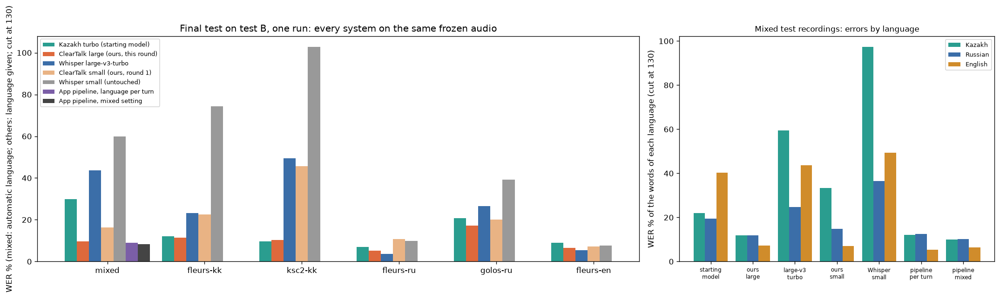
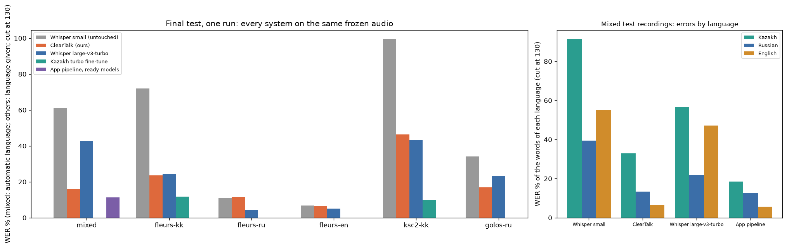
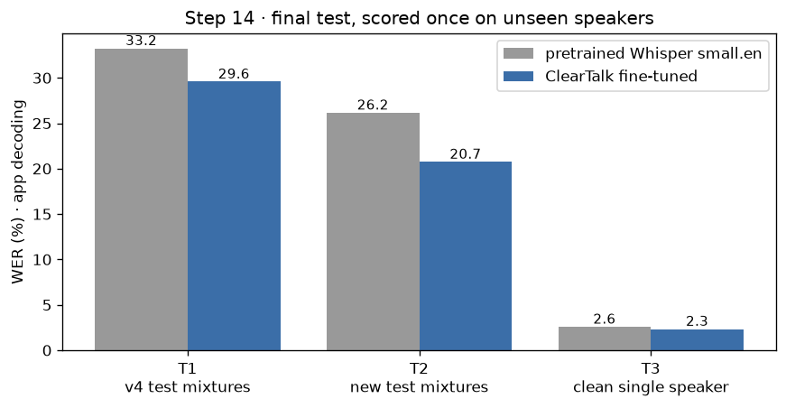

# ClearTalk - распознавание речи, когда говорят несколько человек

ClearTalk превращает запись разговора в текст. У приложения два режима:

- **Разговор** - несколько человек говорят по очереди на **казахском, русском или английском**
  (язык может меняться от реплики к реплике), запись может быть длинной. Приложение находит реплики,
  помечает, кто их произнёс (Speaker 1, Speaker 2 …), определяет язык каждой и пишет текст.
- **Два голоса одновременно** - короткая шумная английская запись, где двое говорят сразу:
  приложение разделяет её на две дорожки и распознаёт каждую.

**Свои обученные модели проекта** - три распознавателя Whisper, дообученные методом **LoRA**:

1. Whisper small.en для голосов, прошедших через разделитель (английский режим двух голосов).
2. Многоязычный Whisper small для казахского, русского, английского и для записей, где язык меняется.
3. Большая многоязычная модель: казахская версия Whisper large-v3-turbo, у которой часть, пишущая текст
   (декодер), дообучена на трёх языках и на записях со сменой языка.

```
Разговор:     запись ─► поиск речи ─► кто говорит (голосовые «отпечатки» + группировка) ─► язык реплики ─► Whisper для этого языка ─► текст
Два голоса:   запись ─► SepFormer (готовый) ─► 2 голоса ─► Whisper small.en (исходный или наш) ─► текст
```

## Результаты: большая многоязычная модель

WER - доля ошибок в словах (меньше - лучше). Все системы получают одни и те же записи и работают через тот
же путь, что и в приложении. Для смешанных записей язык определяется автоматически, для остальных задан.
Точка отсчёта - модель, с которой началось обучение, без изменений.

<!-- multilingual-large-results:start -->
| Набор | Казахская turbo (исходная) | **ClearTalk большая (LoRA)** | Изменение (95% интервал) | Whisper large-v3-turbo | ClearTalk малая (первый раунд) | Конвейер приложения: язык по репликам / «языки меняются в реплике» |
|---|---|---|---|---|---|---|
| **Итоговый тест B** · Смешанные записи (три языка) (170, 6 286 слов) | 30,0% | **9,7%** | -20,3 п.п. (-24,2 … -16,3) | 43,6% | 16,4% | 9,1% / 8,3% |
| **Итоговый тест B** · Казахский · чтение предложений (FLEURS) (170, 2 880 слов) | 12,2% | **11,3%** | -0,8 п.п. (-1,8 … +0,0) | 23,3% | 22,5% | - |
| **Итоговый тест B** · Казахский · эфир и чтение (KSC2) (170, 1 856 слов) | 9,8% | **10,3%** | +0,5 п.п. (-0,5 … +1,7) | 49,5% | 45,6% | - |
| **Итоговый тест B** · Русский · чтение предложений (FLEURS) (170, 3 454 слов) | 6,9% | **5,2%** | -1,7 п.п. (-2,6 … -0,8) | 3,7% | 10,8% | - |
| **Итоговый тест B** · Русский · короткие фразы (Golos) (170, 855 слов) | 20,8% | **17,3%** | -3,5 п.п. (-6,1 … -1,2) | 26,4% | 20,0% | - |
| **Итоговый тест B** · Английский · чтение предложений (FLEURS) (170, 3 874 слов) | 9,1% | **6,6%** | -2,5 п.п. (-3,5 … -1,5) | 5,4% | 7,3% | - |

| Набор | Казахская turbo (исходная) | **ClearTalk большая (LoRA)** | Изменение (95% интервал) | Whisper large-v3-turbo | ClearTalk малая (первый раунд) | Конвейер приложения: язык по репликам / «языки меняются в реплике» |
|---|---|---|---|---|---|---|
| **Валидация** · Смешанные записи (три языка) (300, 10 980 слов) | 30,9% | **9,8%** | -21,1 п.п. (-24,1 … -18,0) | 47,7% | 16,1% | 9,9% / 8,2% |
| **Валидация** · Казахский · чтение предложений (FLEURS) (369, 5 877 слов) | 12,2% | **10,6%** | -1,5 п.п. (-2,3 … -0,8) | 26,2% | 24,2% | - |
| **Валидация** · Казахский · эфир и чтение (KSC2) (400, 4 522 слов) | 9,4% | **10,3%** | +0,9 п.п. (+0,2 … +1,5) | 46,6% | 41,6% | - |
| **Валидация** · Русский · чтение предложений (FLEURS) (356, 6 501 слов) | 7,3% | **5,3%** | -2,0 п.п. (-2,9 … -1,2) | 4,0% | 9,5% | - |
| **Валидация** · Русский · короткие фразы (Golos) (400, 1 925 слов) | 16,8% | **14,2%** | -2,6 п.п. (-3,9 … -1,4) | 21,0% | 15,8% | - |
| **Валидация** · Английский · чтение предложений (FLEURS) (394, 8 241 слов) | 9,7% | **6,9%** | -2,8 п.п. (-3,7 … -2,0) | 5,6% | 7,4% | - |

- Тест B - второй запечатанный набор (по 170 единиц на набор, 1 020 всего): записи, которые в первом тесте не расшифровывала ни одна система. Его открывали **один раз**, после того как состояние модели, маршруты и модель для настройки «Языки меняются в реплике» были зафиксированы на валидации.
- **Главное: записи со сменой языка за один проход.** На итоговом тесте B исходная казахская turbo ошибается в 30,0% слов, наша большая модель - в 9,7%; наша малая модель первого раунда - в 16,4%, Whisper large-v3-turbo - в 43,6%.
- **Казахский:** на начитанных предложениях 12,2% → 11,3%; на эфирной и начитанной речи KSC2 9,8% → 10,3% - на тесте разница в пределах шума (+0,5 п.п. (-0,5 … +1,7)), но на валидации модель **хуже исходной** (9,4% → 10,3%, +0,9 п.п. (+0,2 … +1,5)). Авторы исходной модели обучали её на KSC2 и не пишут, были ли исключены эти тестовые папки, так что её число может быть завышено в её пользу; но факт остаётся: на KSC2 мы её не улучшили.
- **Русский и английский** частично восстановлены: русский 6,9% → 5,2% (FLEURS) и 20,8% → 17,3% (Golos), английский 9,1% → 6,6%. Исходная Whisper large-v3-turbo: русский 3,7% и 26,4%, английский 5,4%.
- **В приложении** (решено по валидации): казахский → наша большая модель, русский → наша большая модель, английский → Whisper large-v3-turbo; настройка «Языки меняются в реплике» → наша большая модель. Конвейер приложения на смешанных записях: язык по репликам - 9,1%, «Языки меняются в реплике» - 8,3%.
- Обучено 2 129 920 параметров из 811 008 000 (0,3%) - только часть модели, которая пишет текст (декодер); слышащая часть заморожена. Одна эпоха, 14 400 примеров (те же, что у малой модели), около 5 часов на GTX 1660 Ti.
<!-- multilingual-large-results:end -->



## Шум, короткие и длинные записи

Как приложение справляется с фоновым шумом, очень короткими фразами и длинными разговорами
(`python -m cleartalk_ml.robustness`).

<!-- robustness-results:start -->
| Проверочные записи | без шума | белый шум 20 дБ | белый шум 10 дБ | голоса фоном 10 дБ | голоса фоном 5 дБ |
|---|---|---|---|---|---|
| Записи со сменой языка (20-30 с) | 8,2% | 11,5% → **10,6%** | 21,7% → **19,0%** | 38,7% → **22,4%** | 67,4% → **41,2%** |
| Разговоры по 7 минут | 11,8% → **8,2%** | - | 25,9% → **15,5%** | 30,2% → **14,9%** | - |
| Короткие фразы ≤ 4 с · казахский | 18,6% | 24,7% → 25,9% | 35,4% | 27,1% → **26,2%** | 44,8% → 48,2% |
| Короткие фразы · русский | 20,8% | 24,2% | 39,9% | 42,1% → **34,8%** | 76,4% → **57,3%** |
| Короткие фразы · английский | 5,8% | 7,7% | 13,2% → **10,3%** | 46,8% → **10,3%** | 28,2% → **16,8%** |

Доля ошибок в словах через приложение (язык определяется для каждой реплики): до → после защит четвёртого раунда; **жирным** - где стало лучше, одно число - без изменений. Шум добавлен к проверочным записям; «голоса фоном» - 3-5 человек говорят на фоне; дБ - насколько речь громче шума. - = не измерялось.

- **Зацикливание** обрезается: слово или фраза, повторённые больше трёх раз подряд, остаются три раза (модель однажды написала «Senate» 213 раз); во всех режимах.
- **Фоновые голоса.** Реплика не длиннее 3 с, которая минимум на 5 дБ тише разговора и не больше чем на 10 дБ громче фона, откладывается: она показана бледным списком под расшифровкой и не входит в текст и файлы. Проверка: 25,2% → 20,7%, -4,5 (-5,5 … -3,5) п.; голоса фоном 10 дБ 32,7% → 22,4%; чистые записи без изменений.
- **Сплошная речь целиком.** Модель получает каждый кусок сплошной речи целиком (пауза на вдох внутри речи одного человека больше не режет фразу), а предложения раздаются говорящим по времени. Проверка: 20,7% → 17,8%, -2,9 (-3,8 … -2,0) п.; чистые разговоры по 7 минут 11,8% → 8,2%.
- **Двое одновременно** - разделение проверено и **не включено**: на записях с наложением ошибок стало 33,7% → 16,0%, но на обычных и шумных разговорах появлялся лишний текст: один голос раскладывался на две дорожки, а люди на фоне записывались как второй голос (проверочные записи 17,8% → 29,0%).

Не включено (каждое по своему правилу, записанному заранее): дообучение большой модели на шуме (шумная проверка 26,3% → 26,7%), два первых варианта распознавания целыми кусками, первый вариант разделения наложений, узкая казахская перепроверка (-0,2 (-0,6 … +0,3) п.). Подробно: `ml_pipeline/round4/PIPELINE.md`.

**Итоговый тест D** (один раз; 898 фраз, которых не видела ни одна модель, каждая без шума, с белым шумом 10 дБ и с голосами фоном 10 дБ; в записи говорит один человек): приложение до → после защит: без шума 13,1% → 13,0% (-0,1 (-0,3 … +0,0) п.), белый шум 10 дБ 32,9% → 28,3% (-4,5 (-9,2 … -1,6) п.), голоса фоном 10 дБ 34,4% → 21,0% (-13,3 (-15,5 … -11,2) п.); всего 26,8% → 20,8%.
<!-- robustness-results:end -->

## Результаты: малая многоязычная модель

Первый раунд обучения. Измерено так же; точка отсчёта - исходный Whisper small. Маршруты приложения, названные
в этом разделе, - те, что были решены после первого раунда; большая модель выше их изменила.

<!-- multilingual-results:start -->
| Набор | Whisper small (исходный) | **ClearTalk (LoRA)** | Изменение (95% интервал) | Whisper large-v3-turbo | Казахская turbo | Конвейер приложения (готовые модели) |
|---|---|---|---|---|---|---|
| **Финальный тест** · Смешанные записи (три языка) (300, 11 852 слов) | 60,9% | **15,9%** | -45,0 п.п. (-49,8 … -41,0) | 42,7% | - | 11,3% |
| **Финальный тест** · Казахский · чтение предложений (FLEURS) (300, 5 411 слов) | 72,0% | **23,6%** | -48,4 п.п. (-52,8 … -45,3) | 24,2% | 11,8% | - |
| **Финальный тест** · Русский · чтение предложений (FLEURS) (300, 5 811 слов) | 11,0% | **11,5%** | +0,5 п.п. (-0,4 … +1,4) | 4,5% | - | - |
| **Финальный тест** · Английский · чтение предложений (FLEURS) (300, 6 736 слов) | 6,7% | **6,4%** | -0,3 п.п. (-0,9 … +0,2) | 5,1% | - | - |
| **Финальный тест** · Казахский · эфир и чтение (KSC2) (300, 3 209 слов) | 99,5% | **46,3%** | -53,2 п.п. (-62,1 … -45,4) | 43,3% | 9,9% | - |
| **Финальный тест** · Русский · короткие фразы (Golos) (300, 1 542 слов) | 34,0% | **16,9%** | -17,2 п.п. (-21,2 … -13,4) | 23,3% | - | - |

| Набор | Whisper small (исходный) | **ClearTalk (LoRA)** | Изменение (95% интервал) | Whisper large-v3-turbo | Казахская turbo | Конвейер приложения (готовые модели) |
|---|---|---|---|---|---|---|
| **Валидация** · Смешанные записи (три языка) (300, 10 980 слов) | 60,0% | **16,1%** | -43,9 п.п. (-49,0 … -39,4) | 47,7% | - | 10,8% |
| **Валидация** · Казахский · чтение предложений (FLEURS) (369, 5 877 слов) | 74,5% | **24,2%** | -50,3 п.п. (-54,0 … -47,1) | 26,2% | 12,2% | - |
| **Валидация** · Русский · чтение предложений (FLEURS) (356, 6 501 слов) | 9,1% | **9,5%** | +0,4 п.п. (-0,4 … +1,1) | 4,0% | 7,3% | - |
| **Валидация** · Английский · чтение предложений (FLEURS) (394, 8 241 слов) | 7,4% | **7,4%** | +0,0 п.п. (-0,5 … +0,5) | 5,6% | 9,7% | - |
| **Валидация** · Казахский · эфир и чтение (KSC2) (400, 4 522 слов) | 103,7% | **41,6%** | -62,2 п.п. (-71,0 … -54,8) | 46,6% | 9,4% | - |
| **Валидация** · Русский · короткие фразы (Golos) (400, 1 925 слов) | 45,0% | **15,8%** | -29,2 п.п. (-55,0 … -15,2) | 21,0% | 16,8% | - |

- Тест открывали **один раз** - после того как шаг обучения, правило продвижения и маршруты приложения были зафиксированы на валидации. В тесте по 300 единиц на набор.
- **Главное: записи со сменой языка.** На финальном тесте исходный Whisper small ошибается в 60,9% слов, наша модель - в 15,9%. Исходная модель после смены языка теряет целые фразы: на валидации пропущенных слов 4 079 → 272; наша лучше на 289 записях из 300.
- **Казахский:** 72,0% → 23,6% на начитанных предложениях. Русский и английский почти не изменились (11,0% → 11,5% и 6,7% → 6,4%) - этого и требовало правило «ни один язык не хуже».
- **Большие готовые модели всё равно сильнее там, где они есть:** на казахском - казахская turbo (11,8%), на русском и английском - large-v3-turbo (4,5% и 5,1%). Поэтому после этого раунда маршруты приложения были: казахский → казахская turbo, русский → Whisper large-v3-turbo, английский → Whisper large-v3-turbo (так решено по валидации; большая модель второго раунда их изменила, см. раздел выше).
- **На смешанных записях лучше всего работает конвейер приложения** (режет запись на реплики и определяет язык каждой): 11,3% с готовыми моделями (маршруты первого раунда) против 15,9% у нашей модели за один проход и 42,7% у large-v3-turbo за один проход.
- Наша модель прошла заранее записанное правило продвижения и стала запасным распознавателем: приложение использует её для всех языков, когда больших моделей на компьютере нет.
- Обучено 6 488 064 параметра из 248 222 976 (2,6%); одна эпоха, 14 400 примеров, из них 9 000 - смешанные записи.
<!-- multilingual-results:end -->



## Результаты: английская модель для двух одновременных голосов

Обе модели получают одни и те же записи. Дикторы ниже **никогда не участвовали в обучении**.

| Набор | Исходный Whisper small.en | **Наш (LoRA)** | Изменение (95% интервал) |
|---|---|---|---|
| **Финальный тест** · новые двухголосые смеси (300 записей, 9 367 слов) | 26,16% | **20,74%** | -5,41 п.п. (-7,63 … -3,65) |
| **Финальный тест** · двухголосые смеси из раннего эксперимента (96 записей, 3 080 слов) | 33,25% | **29,58%** | -3,67 п.п. (-5,61 … -1,88) |
| **Финальный тест** · чистая речь одного человека (400 фраз, 7 494 слова) | 2,58% | **2,34%** | -0,24 п.п. (-0,55 … +0,04) |
| Валидация · двухголосые смеси (300 записей, 9 887 слов) | 28,87% | 21,77% | -7,10 п.п. (-12,87 … -1,87) |
| Валидация · чистая речь (300 фраз) | 2,99% | 2,79% | -0,20 п.п. |

- Тест открывали **один раз** - после того как модель и вариант по умолчанию были выбраны на валидации.
- Обучено 6 488 064 параметра из 248 222 208 (2,6%); одна эпоха, 17 632 разделённые дорожки от 249 дикторов.
- Главный выигрыш - меньше **вставок** (модель перестала дописывать слова второго голоса) и замен.
  Сильнее всего он при шуме 5-15 dB и почти отсутствует при 0 dB, где не справляется сам разделитель.
- Для сравнения, ранний эксперимент (те же 96 смесей, та же старая метрика): рефайнер менял WER с 33,79%
  до 33,69%, а дообучение распознавателя даёт 29,85%.



## Как запустить

**Windows:** дважды щёлкните **Start ClearTalk.bat** в папке проекта. Окно оставьте открытым.

**Mac:** дважды щёлкните **Start ClearTalk.command**. Окно Terminal оставьте открытым.

1. Откроется браузер на http://127.0.0.1:8765. Интерфейс есть на русском и на английском: кнопка в правом
   верхнем углу («English» / «Русский»), выбор запоминается.
2. Загрузите запись, **запишите её с микрофона** («Записать с микрофона») или нажмите на пример.
3. Выберите режим:
   - **Разговор** (Conversation) - язык (автоопределение, казахский / русский / английский или «Языки меняются
     в реплике»), число говорящих (автоматически или от 1 до 8), модель распознавания (лучшая по замерам для
     каждого языка - или конкретная модель, в том числе наша). Запись - до 60 минут.
   - **Разделить и расшифровать** (Separate + transcribe) - два одновременных голоса, английский, до 20 секунд.
   - **Только расшифровать** (Transcribe only) - один голос, английский, до 20 секунд.
4. В результате режима «Разговор» каждая реплика показана отдельно: время (по щелчку запись играет с этого
   места), говорящий, язык, текст. Сомнительные реплики помечены **ПРОВЕРЬТЕ** (CHECK).
5. Остановить приложение: в окне с программой нажмите **Ctrl + C**.

На ноутбуке с видеокартой NVIDIA режим «Разговор» работает на видеокарте, на Mac - на процессоре (медленнее,
но так же). Всё обрабатывается на самом компьютере, ничего никуда не отправляется.

**Без нагрузки на свой компьютер - в Google Colab.** Блокнот `notebooks/ClearTalk_Colab_App.ipynb` запускает
приложение на видеокарте Google и открывает его в отдельной вкладке, доступной только вам (ничего не
публикуется). Перед этим нужно один раз положить архивы из `dist\` на свой Google Диск в папку `ClearTalk`;
пошагово - в самом блокноте. Бесплатный Colab не всегда даёт видеокарту, поэтому его лучше запускать заранее.

Что ещё умеет страница с результатом разговора:

- **Имена говорящих.** Нажмите на «Говорящий 1» и введите имя - оно появится на странице и во всех сохранённых файлах.
- **Исправление текста.** Кнопка «Исправить текст» делает текст и язык каждой реплики редактируемыми.
- **Сохранение.** Текст (`.txt`) или субтитры (`.srt`, `.vtt`) - уже с именами и исправлениями.
- **«Языки меняются в реплике».** Если люди переключают язык посреди реплики, эта настройка отдаёт каждую
  реплику модели, обученной на записях со сменой языка (какая именно - выбрано на проверочных данных и записано
  в `models/multilingual/profile.json`), а не разным моделям по определённому языку.
- **Проверочные примеры.** После исправления текста кнопка «Сохранить как проверочный пример» оставляет запись
  и исправленный текст в папке `data/real/` на этом компьютере (только с согласия всех участников; папка не
  попадает ни в git, ни в архивы). Команда `python -m cleartalk_ml.real` потом считает ошибки каждого способа
  расшифровки на этих настоящих записях. Так приложение можно измерить на живой смешанной речи, которой нет
  в открытых данных.

## Как устроен режим «Разговор»

1. **Поиск речи.** Детектор речи (Silero VAD) находит участки, где кто-то говорит.
2. **Кто говорит.** Каждый участок режется на короткие окна; модель ECAPA-TDNN превращает окно в голосовой
   «отпечаток»; похожие отпечатки объединяются в группы - это и есть говорящие. Число говорящих находится
   само (или задаётся вручную). Порог группировки подобран на проверочных разговорах.
3. **Язык реплики.** Whisper оценивает язык, но выбор ограничен тремя поддерживаемыми языками - иначе короткую
   русскую фразу он может принять, например, за украинскую. Очень короткая реплика берёт язык своего говорящего.
4. **Текст.** Реплика уходит в распознаватель, который на проверочных данных ошибался для этого языка меньше
   всех («маршруты» записаны в `models/multilingual/profile.json`). Можно выбрать и одну модель на всё.
   С настройкой «Языки меняются в реплике» каждая реплика уходит одной модели - той, что меньше всех ошибалась
   на проверочных записях со сменой языка (`mixed_recognizer` в том же файле), а язык реплики читается из
   написанного текста. Две настройки там же, обе приняты по проверочным данным уже после итогового теста:
   реплика, язык которой определён неуверенно (или короче 2 секунд), тоже уходит этой модели - она пишет то, что
   слышит (смешанные проверочные записи: 9,9% → 7,8% ошибок, английский не изменился); а в режиме «Языки меняются в
   реплике» определитель языка вообще не запускается (8,2% → 8,2%, зато на одну тяжёлую операцию на реплику
   меньше - быстрее на компьютере без видеокарты).
5. **Память видеокарты.** Реплики расшифровываются по очереди моделей и потом возвращаются в порядок разговора;
   модель, которая уже не помещается в память видеокарты, выгружается (первой - та, что давно не использовалась).
   Поэтому карты на 6 ГБ хватает при любых маршрутах.

<!-- protections:start -->
6. **Защиты от выдуманного текста** (четвёртый раунд, каждая принята по проверочным данным и правилу, записанному до замера): зацикливание обрезается; короткие тихие реплики на уровне фона откладываются (показаны под расшифровкой); каждый кусок сплошной речи распознаётся целиком, а предложения раздаются говорящим по времени. Разделение одновременной речи проверено и не включено: на обычных разговорах оно добавляло лишний текст.
<!-- protections:end -->

Готовые модели используются как есть: Whisper large-v3-turbo (OpenAI), его казахское дообучение
(shyngys879/kazakh-whisper-large-v3-turbo), многоязычный Whisper small, ECAPA-TDNN (SpeechBrain).

## Что мы обучили в большой многоязычной модели и почему

Это второй раунд обучения. Все шаги, решения и графики - в
[`ml_pipeline/round2/PIPELINE.md`](../ml_pipeline/round2/PIPELINE.md) и ноутбуках рядом с ним.

**Зачем вторая модель.** Ошибки, которые остались у малой модели, - это неверно услышанные слова. Малую модель
на ноутбуке этому не научить. Большие готовые модели слышат хорошо, но в записи со сменой языка продолжают писать
на том языке, с которого начали, или теряют остальное.

- **С чего начали.** Казахская версия Whisper large-v3-turbo (shyngys879/kazakh-whisper-large-v3-turbo): лучший
  казахский среди установленных моделей; русский и английский у неё испорчены, но не потеряны.
- **Что обучали.** Матрицы LoRA только в **декодере** - части модели, которая пишет текст: 2 129 920 параметров из
  811 008 000 (0,3%). Энкодер - часть, которая слышит, - заморожен. Благодаря этому обучение помещается в 6 ГБ
  видеокарты. Те же 14 400 примеров, что у малой модели, одна эпоха, около пяти часов.
- **Второй запечатанный тестовый набор (тест B).** Первый тестовый набор уже был открыт и «потрачен», поэтому до
  начала обучения заморожен новый: 1 020 единиц из тестовых записей, которые в первом тесте не расшифровывала ни
  одна система.
- **Правила, записанные до обучения.** Маршруты приложения - по наименьшей доле ошибок на проверочных данных
  для каждого языка. Модель для настройки «Языки меняются в реплике» - по наименьшей доле ошибок на проверочных
  записях со сменой языка за один проход. И обещание прямо сказать, если казахский стал хуже, чем у исходной модели.

## Что мы обучили в малой многоязычной модели и почему

**Зачем.** Большие готовые модели хорошо знают русский и английский, но обучить их на ноутбуке нельзя
(не хватает памяти видеокарты). Маленький Whisper small обучить можно, но казахский он почти не понимает,
а в записи со сменой языка теряет целые фразы. Мы учим его обоим навыкам.

- **Данные** (все открытые, без регистрации): FLEURS - прочитанные предложения на трёх языках;
  KSC2 - казахская речь (в обучении только начитанная часть, в проверке ещё эфир, парламент, подкасты);
  Golos - короткие русские фразы.
- **Смешанные записи.** Открытого корпуса настоящей смешанной казахско-русско-английской речи мы не нашли,
  поэтому запись со сменой языка собирается: 2-4 фразы на разных языках ставятся друг за другом с короткими
  паузами. Рецепты (какая фраза, где, какой громкости) заморожены, записи пересобираются байт-в-байт.
- **Модель.** Многоязычный Whisper small (248 млн параметров) заморожен; обучаются только матрицы LoRA -
  6 488 064 параметра (2,6%). Одна эпоха: 14 400 примеров, из них 9 000 - смешанные записи. Обучение шло
  на видеокарте GTX 1660 Ti около четырёх часов.
- **Одна метка языка на окно.** Приложение определяет один язык на 30-секундное окно, поэтому смешанной
  записи при обучении давалась одна метка, а писать модель должна была каждую часть на её языке.

**Как защищаемся от переобучения.**

| Роль | Откуда | Зачем |
|---|---|---|
| Train | обучающие части FLEURS и Golos, начало обучающей части KSC2 | обновление весов |
| Validation | проверочные части FLEURS и Golos, половина официального теста KSC2 | выбор скорости обучения, шага, маршрутов |
| Test | тестовые части FLEURS и Golos, вторая половина официального теста KSC2 | одна финальная проверка |

- Роли берутся из официального деления корпусов, а не случайным перемешиванием фраз. Ни одна фраза и ни одно
  предложение FLEURS не встречается в двух ролях - это проверяется кодом. Одинаковые предложения, найденные
  в обучении и в проверке (166 штук), убраны из обучения.
- Смешанная запись собирается только из фраз своей роли.
- Все решения (скорость обучения, шаг, какая модель какому языку) принимались на валидации.
  Тест открыт **один раз** - это контролирует `ml_pipeline/guard.py`.
- Отдельно проверяется, что ни один язык не стал хуже.

**Метрика - WER**: (замены + удаления + вставки) / число слов эталона; может быть больше 100%, если модель
дописывает лишние слова. Перед сравнением убираются регистр и пунктуация, «ё» приравнивается к «е».
Для казахского рядом приводится CER (то же по буквам): казахские слова длинные, одна ошибка в окончании
портит всё слово.

Все шаги, решения и графики - в [`ml_pipeline/PIPELINE.md`](../ml_pipeline/PIPELINE.md) и ноутбуках
`ml_pipeline/01_eda.py` … `04_eval.py` (открыть на Windows: `.venv-train\Scripts\marimo edit ml_pipeline\01_eda.py`).
История английской модели - в [`ml_pipeline_english/PIPELINE.md`](../ml_pipeline_english/PIPELINE.md).

## Что мы обучили в английской модели и почему

**С чего мы начинали.** В раннем эксперименте между SepFormer и Whisper стояла маленькая сеть-«рефайнер»
(10 тыс. параметров), которая чистила звук. Звук она улучшала (+1,4 dB), но ошибки в словах почти не
изменились: 33,79% → 33,69%. Вывод: Whisper ошибается не из-за «грязного» звука как такового, а потому
что никогда не слышал речь с артефактами разделителя и полосой 8 кГц.

**Решение.** Мы учим сам распознаватель понимать такую речь: 8 000 смесей двух дикторов LibriSpeech с шумом
проходят через тот же SepFormer, что и в приложении, и каждая разделённая дорожка становится обучающим
примером. Дикторы в train / validation / test не пересекаются, тест открывался один раз.

## Состав проекта

| Папка | Что внутри |
|---|---|
| `backend/`, `web/` | сервер FastAPI и интерфейс в браузере |
| `cleartalk_ml/` | многоязычная модель: корпуса, смешанные записи, обучение, оценка, экспорт |
| `cleartalk_asr/` | английская модель: смеси, обучение, оценка, экспорт |
| `ml_pipeline/` | журнал пайплайна многоязычной модели, ноутбуки marimo, графики |
| `ml_pipeline_english/` | журнал пайплайна английской модели (закрыт) |
| `data/ml/plans/`, `data/asr/plans/` | замороженные рецепты смешанных записей и смесей |
| `data/ml/results/` | расшифровки и оценки на валидации и тесте |
| `scripts/` | загрузка моделей и данных, запуск обучения, выбор чекпойнта, упаковка |
| `tests/` | тесты сервиса и кода обучения (`pytest`) |

## Ограничения (честно)

<!-- multilingual-limits:start -->
- **Наша многоязычная модель - маленькая.** Она намного лучше исходного Whisper small на казахском и на записях со сменой языка, но уступает большим готовым моделям (см. таблицу), а на русском чуть хуже исходной (9,1% → 9,5% на валидации).
- **Казахская речь вне начитанных текстов остаётся трудной** и для нашей модели: на валидации radio - 69,6%, podcasts - 59,5%, talkshow - 57,7% (в обучении был только источник crowdsourced).
- **Метку языка наша модель ставит хуже, чем пишет текст**: казахскую речь она сама помечает как казахскую в 74,0% случаев (исходная - в 95,1%). Поэтому для её реплик приложение читает язык из написанного текста (на валидации верно в 100% и 97% случаев).
<!-- multilingual-limits:end -->
<!-- overlap-limits:start -->
- **Люди, говорящие одновременно, в режиме «Разговор» не разделяются**: слова могут потеряться или достаться одному говорящему. Разделение было сделано и проверено (четвёртый раунд), но не включено: на записях с наложением оно вдвое уменьшало ошибки, а на обычных разговорах добавляло лишний текст. Для двух одновременных голосов есть английский режим.
  Исключение (добавлено 19.10.2026 как демонстрация): если в «Говорящие» выбрать «2 · говорят одновременно», запись до 30 с делится на два голоса и каждый расшифровывается отдельно, на любом из трёх языков (примеры - `samples/two_voices_kk_ru_en/`). Включается вручную, на тестовом наборе не измерялось.
- **Отложенные «фоновые» реплики стоит просмотреть**: тихий настоящий ответ в шумной комнате может оказаться среди них.
<!-- overlap-limits:end -->
- **Speaker 1 / 2 … - условные метки внутри записи**, а не опознанные люди. Разметку говорящих мы проверяли
  только на собранных разговорах, где голоса отличались языком или полом; дикторов одного пола и языка
  проверить было нечем (в корпусах нет идентификаторов дикторов).
- **Смешанная речь собрана из отдельных фраз**: каждая смена языка - это и смена диктора и микрофона.
  Как модель поведёт себя, когда один человек меняет язык посреди фразы, не измерялось.
- Обучение и проверка - на начитанных предложениях, коротких фразах и эфирной речи. На живых разговорах,
  с акцентами и другими микрофонами качество может быть хуже. Транскрипт нужно проверять.
- В корпусах нет идентификаторов дикторов, поэтому нельзя доказать, что дикторы обучения не встречаются в
  проверке (предложения - не встречаются, это проверено).
- Английский режим двух голосов: только английский, до 20 секунд, ровно два голоса; на 28 фрагментах
  настоящих встреч (AMI) наша английская модель не оказалась лучше исходной (34,1% против 29,2%, разница
  статистически не различима).
- Видео и чтение по губам не реализованы.
